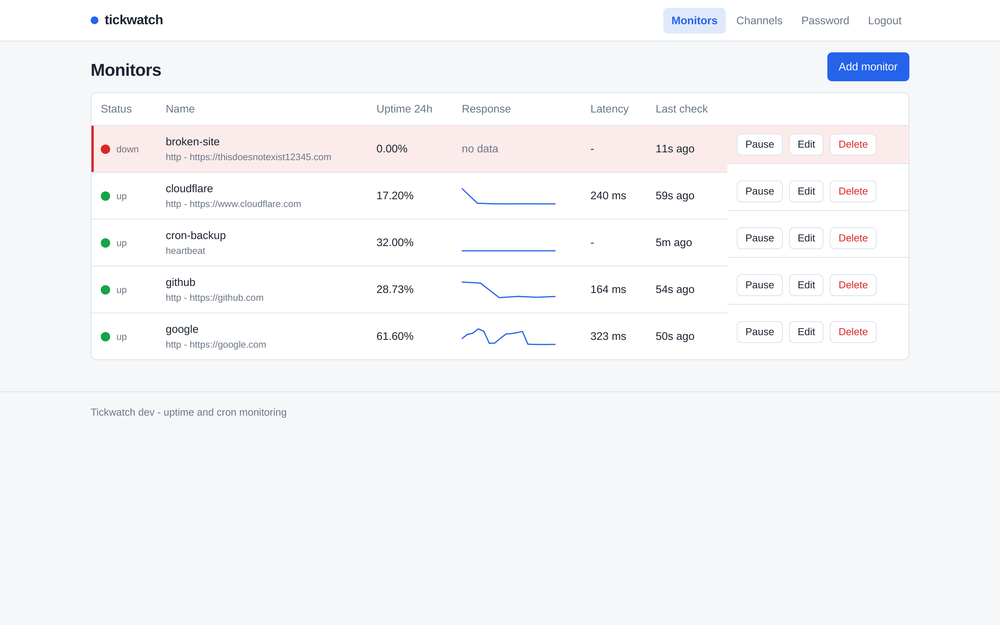
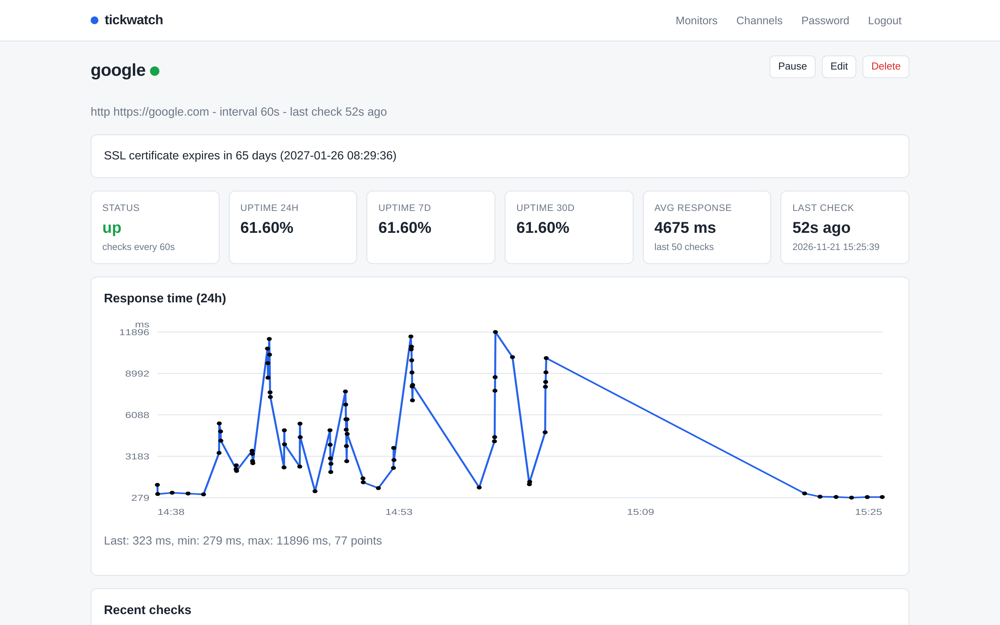
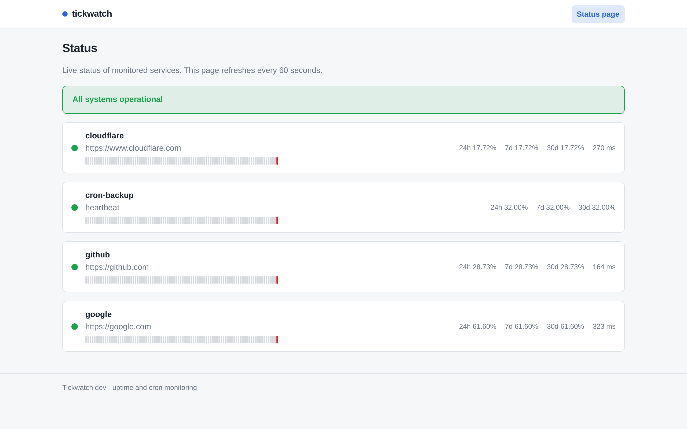
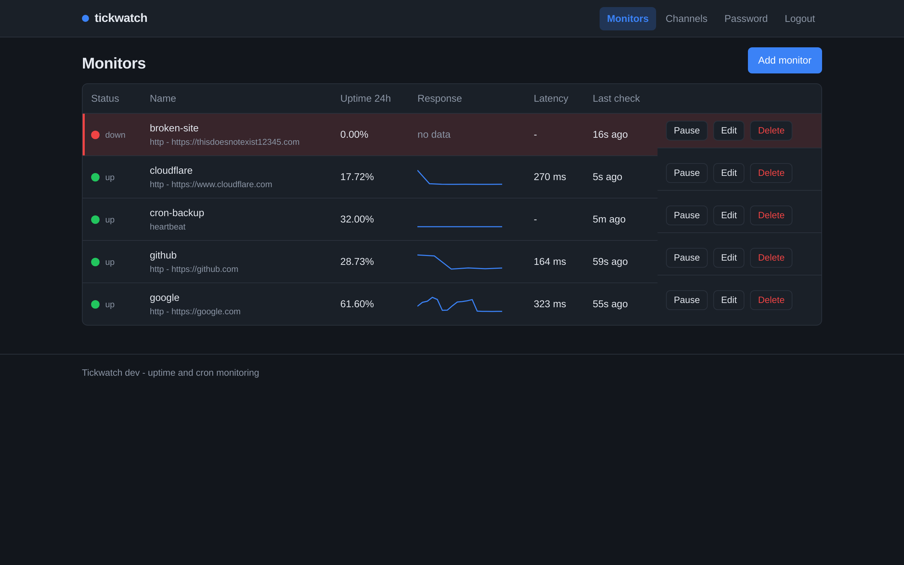

<p align="center"></p>

# Tickwatch

[](https://github.com/chaggangamer/tickwatch/actions/workflows/ci.yml)
[](LICENSE)
[](https://go.dev)

Self-hosted uptime and cron monitoring in a single Go binary. Tickwatch checks websites,
APIs, TCP ports and cron jobs on a schedule, records every check, opens incidents when
things break, and sends alerts to Telegram, Slack, Discord, email or a generic webhook.

Free and open source under the MIT license. The architecture keeps clean seams for a
future hosted edition (multi-user, teams, multi-region checks) without building paid
features now.

Building from source requires Go 1.26 or newer (see go.mod). The released binaries and
the Docker image have no toolchain requirements.

## Features

- HTTP/HTTPS checks with method, headers, body, expected status codes, body substring
  or regex match, redirect handling and SSL expiry tracking
- TCP port checks
- ICMP ping with automatic TCP fallback when raw sockets are not permitted
- Heartbeat monitors for cron jobs: call a unique ping URL on success, Tickwatch alerts
  when no ping arrives within the expected period plus grace
- Per-monitor interval (minimum 20 seconds), timeout, retries, failure threshold
- A monitor goes DOWN after N consecutive failures and UP after one success
- Incidents with start, end, duration and reason
- Uptime percentages for 24h, 7d, 30d and 90d
- Raw results kept  configurable days (default 30), then aggregated into hourly summaries
- Alerts with per-monitor cooldown so one outage does not spam the channel
- Dashboard with live status, response time sparklines and an SVG response time chart
- Public status page at /status for monitors you mark as public
- REST API with token auth for monitors, channels and incidents
- Single YAML config plus environment variable overrides
- SQLite storage (no CGO), everything embedded in one static binary

## Screenshots

| Dashboard | Monitor detail |
| --------- | -------------- |
|  |  |

| Status page | Dark mode |
| ----------- | --------- |
|  |  |

Capture guide: [docs/screenshots/README.md](docs/screenshots/README.md).

## Quick start

From source:

```sh
git clone https://github.com/chaggangamer/tickwatch
cd tickwatch
go build ./cmd/tickwatch
./tickwatch serve
```

With Docker Compose:

```sh
git clone https://github.com/chaggangamer/tickwatch
cd tickwatch
docker compose up -d --build
```

Compose stores data in the named volume `tickwatch-data` (mounted at `/data` in the
container). Inspect it with `docker volume inspect tickwatch-data`.

Open http://localhost:8080 and complete the setup page to create the admin account.
Until the first admin exists, every dashboard request is redirected to the setup page
and it disappears as soon as one is created. For automated deployments, set
`TICKWATCH_ADMIN_PASSWORD` (minimum 8 characters) and Tickwatch creates the admin at
boot instead.

**Security note:** complete setup before exposing the instance to the internet. While
no admin exists, anyone who can reach the instance can claim the administrator account.

## Configuration

Tickwatch reads an optional YAML file and overrides with environment variables.

```sh
tickwatch serve --config /etc/tickwatch/tickwatch.yml
```

| Key | Env | Default | Description |
| --- | --- | ------- | ----------- |
| `server.listen` | `TICKWATCH_LISTEN` | `:8080` | HTTP listen address |
| `server.base_url` | `TICKWATCH_BASE_URL` | - | Public URL, used in alert messages and ping URLs |
| `database.path` | `TICKWATCH_DB_PATH` | `tickwatch.db` | SQLite file path |
| `log.level` | `TICKWATCH_LOG_LEVEL` | `info` | debug, info, warn or error |
| `scheduler.workers` | `TICKWATCH_WORKERS` | `16` | Concurrent check workers |
| `retention.raw_days` | `TICKWATCH_RAW_DAYS` | `30` | Days to keep raw check results |
| `retention.summary_days` | `TICKWATCH_SUMMARY_DAYS` | `365` | Days to keep hourly summaries |
| `ssrf.block_private` | `TICKWATCH_SSRF_BLOCK_PRIVATE` | `false` | Forbid checks against private and loopback addresses |
| `admin.username` | `TICKWATCH_ADMIN_USERNAME` | `admin` | Initial dashboard user |
| `admin.password` | `TICKWATCH_ADMIN_PASSWORD` | generated | Initial dashboard password |

See [tickwatch.example.yml](tickwatch.example.yml) for a commented file.

## Monitor types

| Type | What it does | Key options |
| ---- | ------------ | ----------- |
| `http` | Requests a URL and validates the response | method, headers, body, expected status (`200-299`), body contains, body regex, follow redirects |
| `tcp` | Opens a TCP connection to host:port | host, port |
| `ping` | Sends an ICMP echo request | host; falls back to TCP 80/443 when ICMP is unavailable |
| `heartbeat` | Expects a ping to a unique URL | period, grace; DOWN when no ping arrives within period + grace |

Cron monitoring: create a heartbeat monitor, copy the ping URL shown on the monitor
page, and call it at the end of your job:

```sh
curl -fsS --retry 3 https://tickwatch.example.com/ping/<token> > /dev/null
```

## Alert channels

Configure channels in the dashboard under Channels, then select them per monitor.

| Type | Required config |
| ---- | --------------- |
| Telegram | bot token, chat id |
| Slack | incoming webhook URL |
| Discord | webhook URL |
| Email | SMTP host, port, username, password, from, to |
| Webhook | URL, optional secret sent as the `X-Tickwatch-Secret` header |

Tickwatch alerts on DOWN, on RECOVERY, and on SSL expiry at 30, 14 and 7 days. A
per-monitor cooldown suppresses repeated DOWN notifications for one incident; a new
incident always notifies immediately. Every channel has a test button.

Secrets are stored in the database and never returned by the API or the dashboard in
plain text; the UI shows masked values and keeps the stored secret when you leave a
field blank. Secrets are never written to logs.

## API overview

Token auth: `Authorization: Bearer <token>`. Create tokens with
`tickwatch token add <name>`. Errors always use:

```json
{"error": {"code": "...", "message": "..."}}
```

| Method | Path | Description |
| ------ | ---- | ----------- |
| GET | `/healthz` | Liveness and database check |
| GET/POST | `/ping/{token}` | Heartbeat ping |
| GET | `/api/v1/monitors` | List monitors with uptime stats |
| POST | `/api/v1/monitors` | Create monitor |
| GET/PUT/DELETE | `/api/v1/monitors/{id}` | Read, update, delete |
| GET | `/api/v1/monitors/{id}/results` | Check results, paginated with `page` and `per_page` |
| GET | `/api/v1/monitors/{id}/incidents` | Incidents for one monitor |
| GET | `/api/v1/incidents` | All incidents |
| GET/POST | `/api/v1/channels` | List, create alert channels |
| GET/PUT/DELETE | `/api/v1/channels/{id}` | Read, update, delete |
| POST | `/api/v1/channels/{id}/test` | Send a test notification |

Example:

```sh
curl -H "Authorization: Bearer $TOKEN" http://localhost:8080/api/v1/monitors
```

## CLI

```
tickwatch serve [--config path]
tickwatch add http https://example.com --interval 60
tickwatch add tcp db.internal:5432
tickwatch list
tickwatch migrate
tickwatch token add ci
tickwatch token list
tickwatch version
```

## FAQ

**Does Tickwatch support multi-user setups?**
Not yet. Version 1 has a single dashboard user. The user model sits behind the
`store.Store` interface so a hosted edition can extend it.

**How is this different from a hosted service?**
Nothing leaves your machine. Checks run locally, data stays in your SQLite file.

**Why does my monitor show up while the site is broken for me?**
Checks run from wherever Tickwatch runs. Network path differences matter; run
Tickwatch close to the users that matter to you.

**Does ICMP ping need root?**
On Linux, raw ICMP sockets need privileges. Without them Tickwatch automatically
falls back to TCP checks on ports 80 and 443 and says so in the error message.

**How do I back up?**
Copy the SQLite file (or use `sqlite3 tickwatch.db ".backup backup.db"`). Everything
lives in that one file.

**The container logs "unable to open database file". What is wrong?**
The container runs as a non-root user (uid 65532) and cannot write where the database
file points. With docker compose this should not happen: the named volume is
initialized with the correct ownership from the image. If you replace the volume with
a bind mount (`./data:/data`), the host directory must be writable by uid 65532 — run
`chown 65532:65532 ./data` on the host, or use `docker compose down` and switch back
to the named volume. The same applies when pointing `database.path` at any other
directory: it must exist and be writable by uid 65532.

**Can I monitor internal services?**
Yes. Self-hosted installs allow private addresses by default; set
`ssrf.block_private: true` if your users can add arbitrary targets.

## Roadmap

- Teams and multiple users behind the existing store interface
- Remote check regions for geo-aware monitoring
- Prometheus metrics endpoint
- Per-check tags and grouping
- Maintenance windows

## Known issues

- Heartbeat monitors compute uptime from stored check rows, so a long
  outage can make the percentage look lower than the real downtime.
- Alert channels (webhook, Slack, Discord, Telegram, SMTP) are not covered
  by the private-address block yet.
  
## Comparison with Uptime Kuma

Uptime Kuma is a great tool and more mature. Honest differences:

- Uptime Kuma runs on Node.js with a large UI surface and many integrations; Tickwatch
  is one static Go binary with SQLite, no JavaScript build step and a smaller scope.
- Uptime Kuma has more notification providers, proxies, DNS monitors and push options.
  Tickwatch covers the common five channels and focuses on doing them well.
- Tickwatch ships a token-authenticated JSON API designed for automation and a CLI
  for headless setup; Uptime Kuma's API surface is less formal.
- Tickwatch aggregates raw results into hourly summaries with a fixed retention
  policy out of the box; useful for long-running self-hosted instances.
- If you want the widest integration set and a plugin-style ecosystem, use Uptime
  Kuma. If you want a small binary, an API-first design and plain SQL data you can
  query directly, Tickwatch is a good fit.

## License

MIT. See [LICENSE](LICENSE).
